# Rigside

I wanted something nice on the little screen next to my monitor, so I made this. It shows the time, the
weather, what's playing, your PC temps and some macro buttons, on top of a pixel art scene that changes with
the real time of day and weather outside.

Put it on a small USB screen, a spare monitor, a bar screen or a corner of your main one. It's free and open
source (MIT), runs on Windows 10 and 11, and it's about a 3 MB download. No account, no tracking. It only goes
online for the weather (Open-Meteo) and a daily update check (GitHub), and you can turn that off.

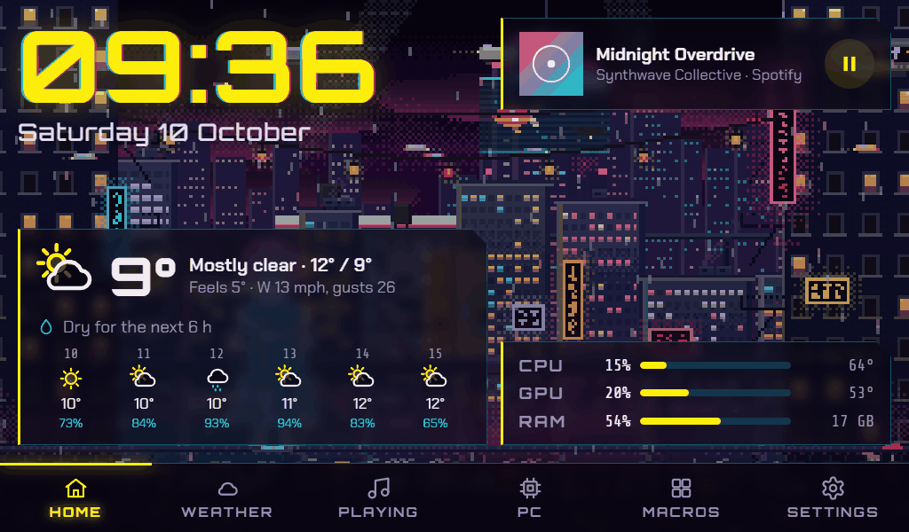

## What it does

There are five tabs, and you can reorder them or hide the ones you don't want. On a touch screen you can
swipe between them.

- **Home** is the one I leave up most of the time: a big clock, the weather now and for the next few hours
  (with things like "Rain from 14:20" or "Dry for 3 h"), what's playing and your CPU/GPU/RAM.
- **Weather** has the next 24 hours as a chart, the week ahead, wind, humidity, UV, sunrise and sunset, the
  moon and air quality. It works anywhere in the world.
- **Playing** shows whatever's playing on your PC, from Spotify, a browser, VLC or anything else that shows up
  in Windows' media controls. You get album art, play/pause/skip, volume, mic mute, a button to flip between
  headphones and speakers, and a visualiser.
- **PC** has CPU and GPU load and temps, VRAM, power, memory, network, drives and uptime.
- **Macros** are big buttons that open apps, games, folders or websites, or press a key combo for you
  (Discord mute, OBS record, Game Bar clips, that sort of thing).

If you only have one screen there's also an overlay: a small strip with your stats that stays on top of
everything and lets clicks go straight through it. Ctrl+Shift+O shows and hides it (you can change the key).

It should fit whatever screen you've got: 800x480 and 1024x600 panels, 1920x480 and 2560x720 bar screens,
portrait screens or a normal monitor.

| Weather | Playing |
| --- | --- |
| 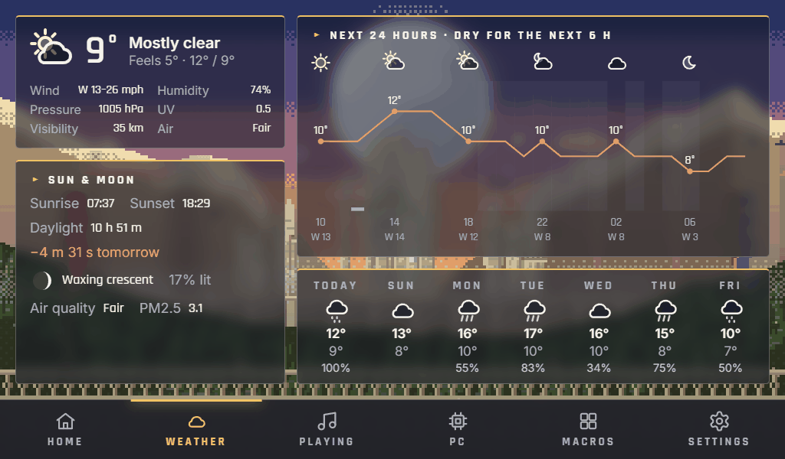 | 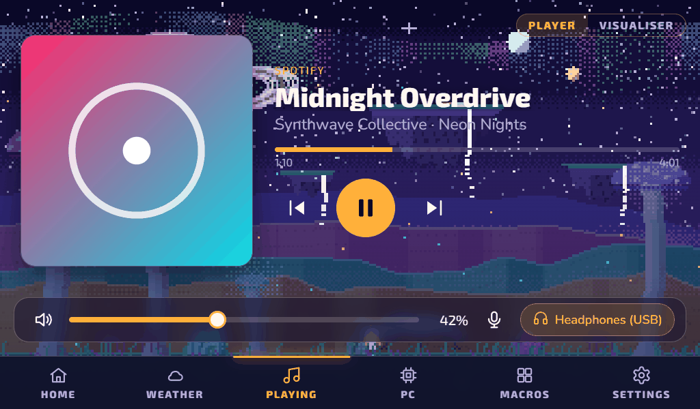 |

Here it is on a 1920x480 bar screen:

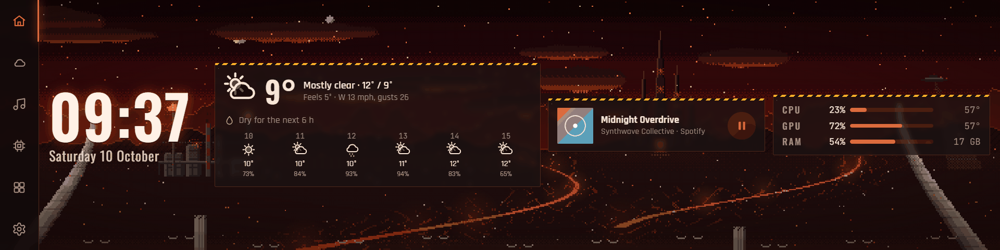

## Themes

Each theme has its own animated scene, and they all follow your real sunrise and sunset and the weather where
you live, so if it's raining outside it's raining in the scene too.

| | |
| --- | --- |
| 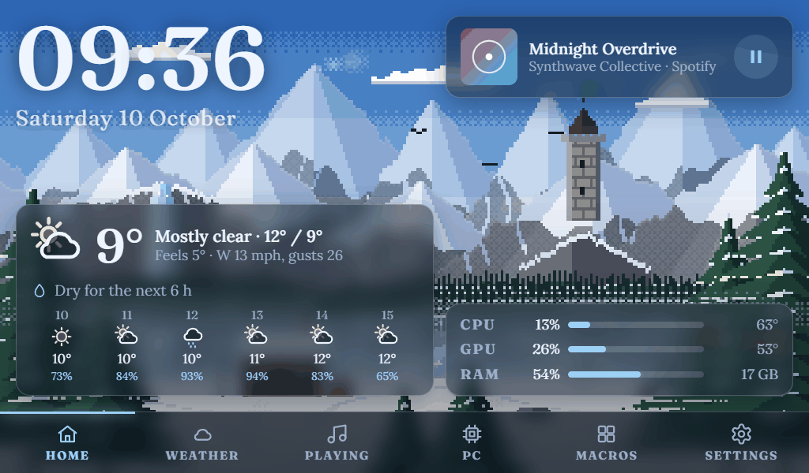 | 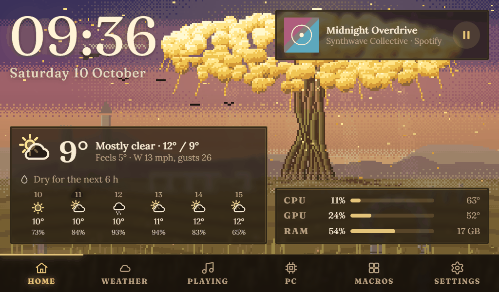 |
| 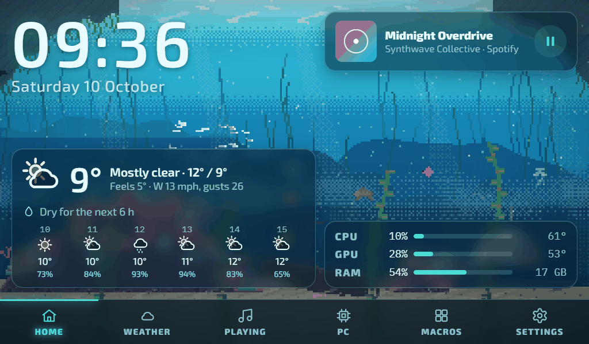 | 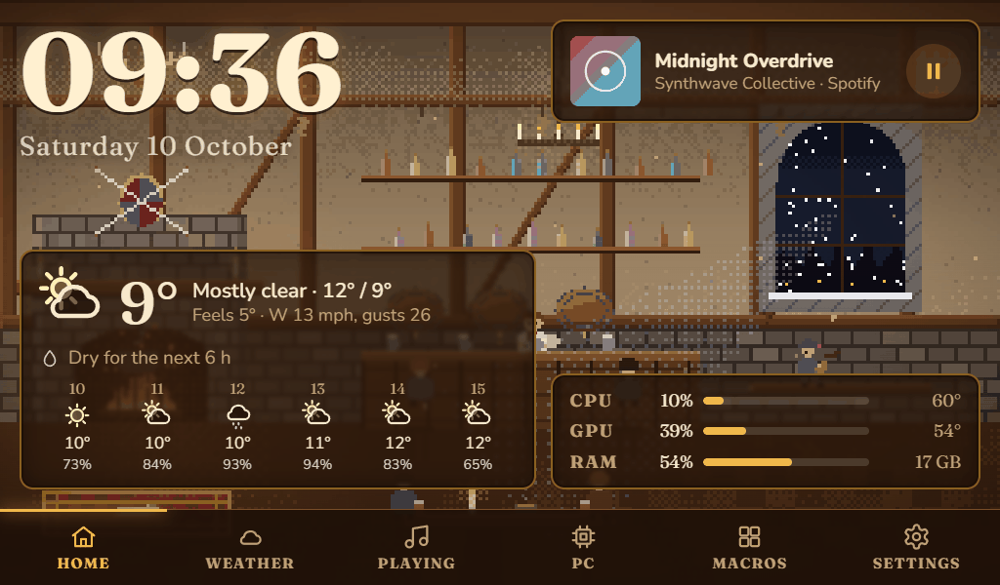 |
| 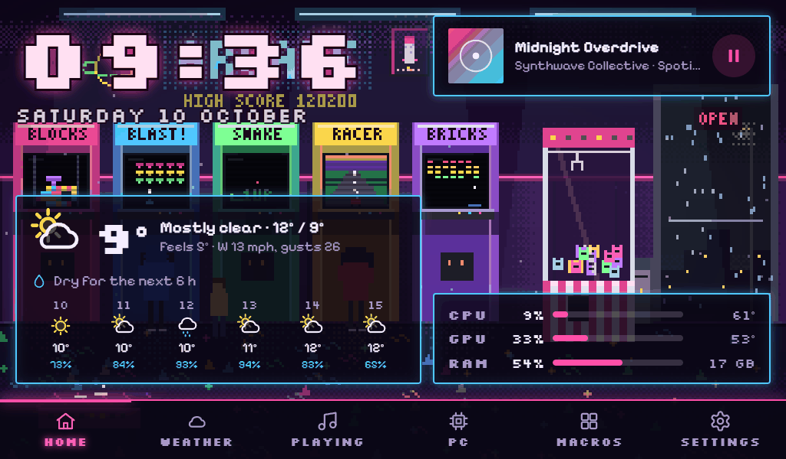 | 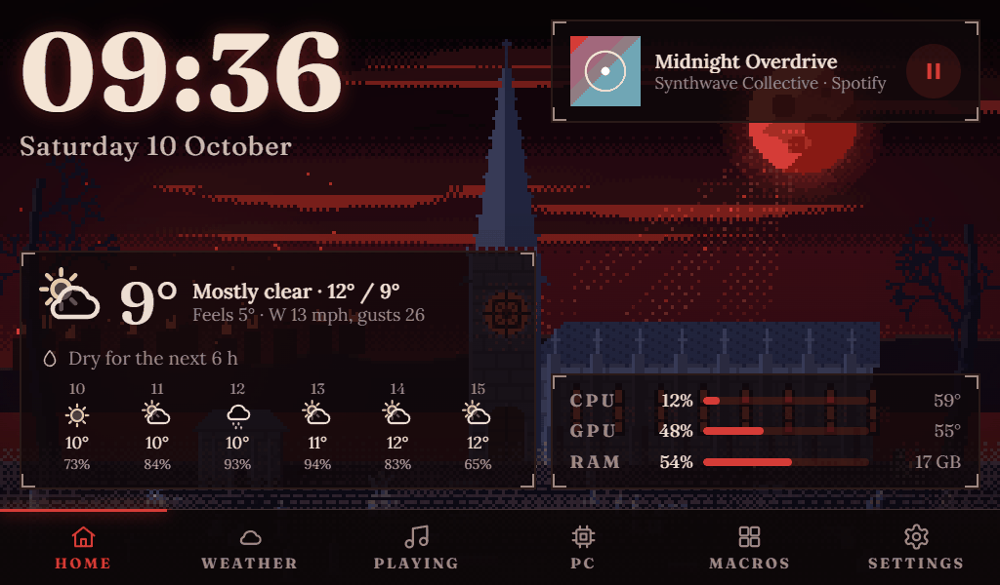 |
| 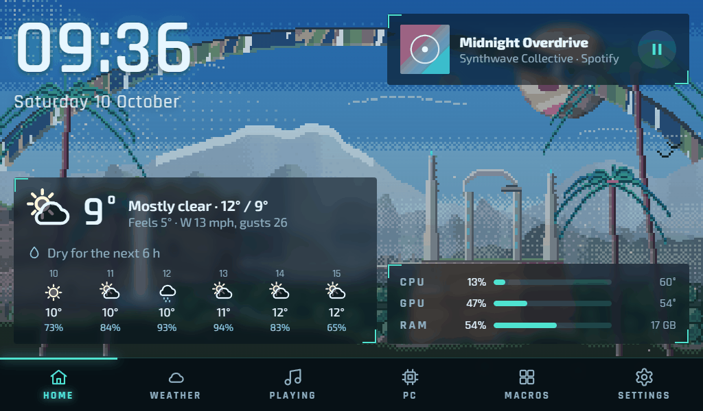 | 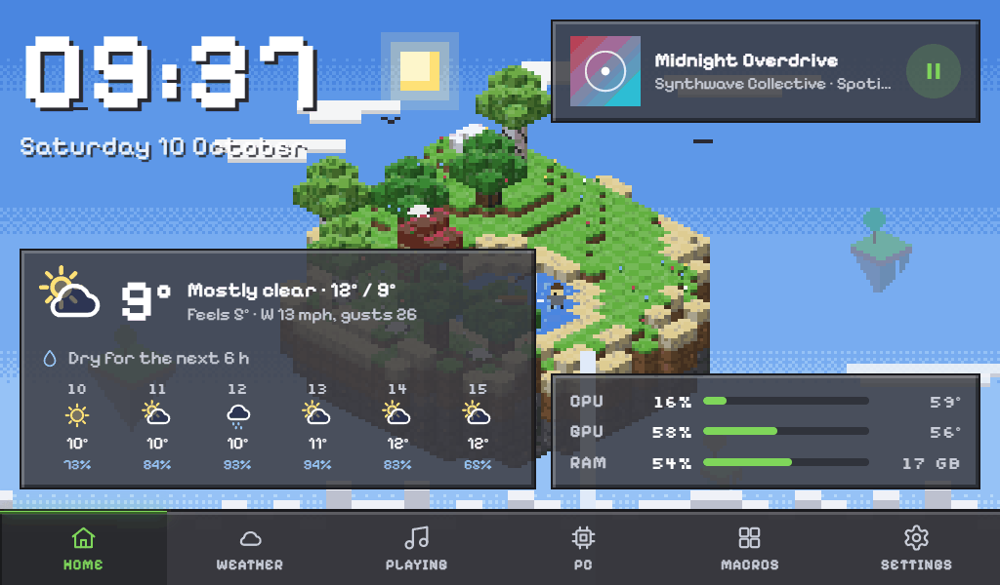 |
| 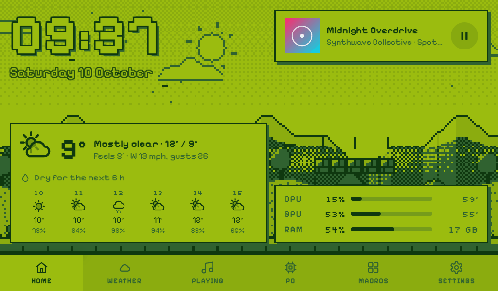 | |

| Theme | What you get |
| --- | --- |
| Ringworld | An alien valley under a huge ring in the sky |
| Starfarer | A colourful alien planet, a ringed giant and your ship parked on the grass |
| Relay | A ring gate in orbit with ships jumping through it, and a planet below |
| Last City | A walled city of towers under a giant pale sphere |
| Hellforge | Lava rivers, a burning refinery and a castle of spires |
| Neon City | A rainy megacity with neon signs, flying cars and a big hologram |
| Wasteland | A ruined skyline on an old green-screen terminal |
| The Zone | An abandoned exclusion zone with anomalies, and a blowout every so often |
| Deep | A reef, sunlight coming down through the water, an underwater base and something big |
| Sanctum | A ruined cathedral, a blood moon and a graveyard |
| Golden Tree | A massive glowing tree over misty ruins |
| Tavern | A cosy inn with a fire going and the weather at the window |
| Frostpeak | Snowy mountains, the northern lights and something with wings |
| Blocks | A floating island made of blocks, with a waterfall |
| Arcade | Arcade cabinets and a claw machine after dark |
| Pocket | A four-colour handheld-style world scrolling past |
| Overworld | 16-bit fields, a castle, slimes and a little hero |
| Minimal | No animation at all, if you want the lowest CPU use |

All the scenes are original, nothing's taken from any game. They run at 10 frames a second (3 in Low power
mode), stop when the window's hidden, and you can have them slow down or pause while you're playing something
full screen (Settings → Theme → While gaming).

## How heavy is it?

Not very. I wanted it running all day next to games without me noticing. On my PC (Ryzen 7 9800X3D,
RTX 4070, 32 GB RAM), with a 1024x600 window and the Wasteland theme fully animated, it uses:

- about **0.5% CPU** (half a percent of the whole processor)
- about **0.3% GPU**
- about **35 MB of RAM** for Rigside itself, or around **330 MB** counting WebView2

WebView2 is the Edge engine that comes with Windows. It's what draws the window, and it's most of that
memory. The installer is under 3 MB because it uses the copy that's already on your PC instead of bundling
its own browser.

If you want it lighter still, Low power mode drops the scenes to 3 frames a second, Minimal turns the
animation off completely, and when the window's minimised or hidden nothing gets drawn at all.

## Temperatures

Windows can't read your CPU temperature without a kernel driver, and I didn't want Rigside installing one
(drivers like that can upset anti-cheat). So instead it borrows the readings from one of these if you have
it running:

- [LibreHardwareMonitor](https://github.com/LibreHardwareMonitor/LibreHardwareMonitor): turn on Options →
  Remote Web Server → Run. A few things to know:
  - It has to run as administrator or it can't see CPU temps.
  - Turn on Options → Run On Windows Startup, otherwise the temps go missing after a reboot.
  - Its web server (port 8085) is open to your whole network, not just your PC. If that bothers you, block
    inbound 8085 in Windows Firewall. Rigside reads it from the same PC, so it carries on working.
- [HWiNFO](https://www.hwinfo.com/): turn on Settings → Shared Memory Support. The free version switches that
  off again after 12 hours, so if your temps go blank, turn it back on or restart HWiNFO.

NVIDIA GPU temp, load, VRAM and power work without either of them.

## Install

Grab the installer from [Releases](../../releases) and run it. Windows might say "Windows protected your PC",
because I haven't paid for a code signing certificate. Click **More info → Run anyway**. After that it keeps
itself up to date.

To put it on your second screen, go to Settings → Display and press **Fill** next to that screen. F11 flips
full screen on and off.

## Bugs, questions and ideas

If something's broken, the easiest way to tell me is **Settings → About → Report a problem** in the app. It
opens the bug form with your version already filled in. **Copy system info** and **Open log folder** (for
`rigside.log`) on the same page help a lot. You can also go straight to
[Issues](https://github.com/Ni-Rou/rigside/issues/new/choose).

Questions like "how do I get CPU temps showing?" are best in
[Discussions](https://github.com/Ni-Rou/rigside/discussions/categories/q-a). Ideas for features or new themes
are welcome too, either as a Feature idea in Issues or in
[Discussions](https://github.com/Ni-Rou/rigside/discussions/categories/ideas).

## Building it yourself

You'll need [Rust](https://rustup.rs/), Node.js and the Visual Studio C++ Build Tools.

```
npm install
npm run tauri dev      # run it, reloading the UI as you edit
npm run tauri build    # makes the installer in src-tauri/target/release/bundle/nsis/
```

`tauri build` also signs the update files, which needs my private key. You won't have that, so build with
update signing turned off:

```
npm run tauri build -- --config "{\"bundle\":{\"createUpdaterArtifacts\":false}}"
```

The UI is just HTML, CSS and JS in `src/`, no bundler. You can work on it in a normal browser with fake data:
serve `src/` (for example `python -m http.server -d src 5173`) and open http://localhost:5173. Some handy URL
options: `?theme=frostpeak`, `?bare` for just the scene, and
`?scene_time=22:30&scene_weather=snow&scene_temp=-3` to see any time and weather.

`rigside.exe --probe` prints everything Rigside can read from your PC as JSON, which is useful for bug
reports.

### Making a theme

1. Add it to `src/js/themes.js` (id, name, family, scene).
2. Put its colours, fonts and panel style in `src/css/themes.css` under `[data-theme="<id>"]`.
3. Write the scene in `src/js/scenes/<id>.js`. The top of `src/js/scene.js` explains how scenes work, and
   `src/js/pixel.js` has helpers for mist, glows, smoke, light shafts and so on.
4. Add a `<script src="js/scenes/<id>.js">` tag to `src/index.html`.

Please only send in your own art. No game logos, names, ripped sprites, screenshots or official fonts, or
the project could get taken down.

## Licence

MIT. See [LICENSE](LICENSE) and [THIRD-PARTY.md](THIRD-PARTY.md).
